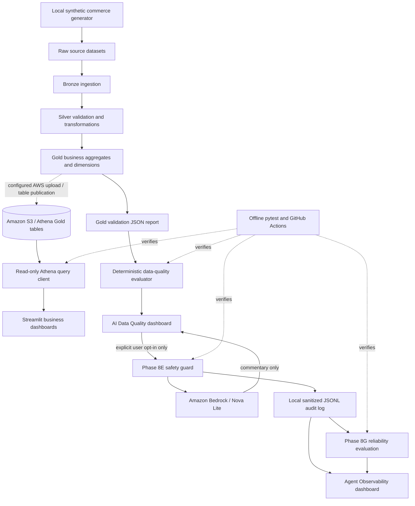

# AegisData AI

**AWS-powered data engineering, analytics, and guarded agentic data-quality intelligence**

[](https://github.com/ayomikunadaramola/aegisdata-ai/actions/workflows/ci.yml)
[](https://github.com/ayomikunadaramola/aegisdata-ai/actions/workflows/phase8g.yml)
[](https://github.com/ayomikunadaramola/aegisdata-ai/actions/workflows/phase8h.yml)

**Repository:** https://github.com/ayomikunadaramola/aegisdata-ai  
**Status:** Release candidate, ready for manual review. Published source inventory and GitHub offline CI have passed; local Phase 8J-D reconciliation reported 29/29 successful checks. **Not a production deployment or certification.**  
**License:** [MIT](LICENSE)

## Overview

AegisData AI is an end-to-end engineering portfolio project that connects **synthetic commerce data generation**, a **Bronze → Silver → Gold** processing design, AWS-backed analytical storage and queries, an **eight-view Streamlit dashboard**, and an **optional Amazon Bedrock data-quality explanation agent**. The design emphasizes data correctness, traceable checks, explicit AI opt-in, failure-safe behavior, and offline regression testing.

The current demonstrated workflow combines a local data pipeline and Gold validation report with AWS Athena analytics. The AI data-quality agent reads the local Gold validation result, produces deterministic findings, and can request **non-authoritative** natural-language commentary from Amazon Nova Lite. A model response cannot change the validation outcome or execute remediation.

> **Publication note:** Bronze ingestion, Silver/Gold scripts, SQL analytics, Terraform source, dashboards, and Phase 8 agent modules are now published on `main`. Published source alone does **not** establish a fully reproducible cloud deployment. See [Release-readiness checklist](#release-readiness-checklist).

## Architecture



The dotted Gold-to-AWS transition is a **deployment/publication boundary**, not a guarantee that a new clone automatically provisions cloud resources or uploads data.

## Technology stack

| Layer | Technologies / role |
| --- | --- |
| Language and data | Python 3.12 (development baseline), pandas, NumPy, PyArrow |
| Batch processing | PySpark 3.5, local Parquet processing |
| Cloud infrastructure | AWS, Amazon S3, AWS IAM, Terraform configuration |
| Analytics | Amazon Athena, SQL, Gold data models |
| Application | Streamlit, Plotly/Altair where used, boto3 |
| Agentic AI | Amazon Bedrock Runtime `Converse`, Amazon Nova Lite, deterministic rules and safety guard |
| Observability | Sanitized local JSONL audit events, token/latency statistics, rolling reliability evaluator |
| Quality and automation | pytest, Python syntax checks, Git, GitHub Actions |

The package metadata in [`pyproject.toml`](pyproject.toml) permits Python `>=3.11,<3.14`; the documented development and CI environment uses **Python 3.12**.

## Data engineering lifecycle

### 1. Generate synthetic source data

The project uses synthetic business entities such as **customers, products, orders, and payments** to exercise an e-commerce-style pipeline without real customer records. Generate source data using the local generator implementation, then review the output schema, keys, timestamps, missingness, and referential relationships before ingestion.

**Important:** Generator commands and arguments should be confirmed against the local script before publishing a one-command reproduction recipe. The current repository inventory includes a local generator-related script (`debug_generators.py`), but the complete generator entry point is not yet verified in the published Git tree.

### 2. Bronze: ingest raw data

**Published source:** [`ingestion/batch/bronze_ingest.py`](ingestion/batch/bronze_ingest.py).

Bronze is the raw ingestion layer. It preserves source records and organizes ingestion runs into identifiable batches so later stages can determine which input was processed. A batch should be considered usable only after required datasets and completion criteria are satisfied; incomplete batches must not silently flow downstream.

**Operational checks:** input availability, source schema, batch completeness, error reporting, and repeatability. The project also includes a local `tests/test_bronze_ingestion.py` test module.

### 3. Silver: inspect, validate, and standardize

**Published sources:** [`pipelines/silver/inspect_bronze.py`](pipelines/silver/inspect_bronze.py) and [`pipelines/silver/transform_silver.py`](pipelines/silver/transform_silver.py).

Silver reads a complete Bronze batch, evaluates source compatibility and relationships, applies transformations, and produces cleaner typed datasets suitable for business modelling. Checks should cover nulls, invalid values, duplicates, date and type conversions, and relationships among customers, orders, products, and payments. The Silver transformation test is maintained in `tests/test_silver_transformation.py`.

### 4. Gold: construct analytical models

**Published source:** [`pipelines/gold/build_gold.py`](pipelines/gold/build_gold.py); historical `build_gold_v1.py` through `build_gold_v5.py` are tracked for development traceability. **Verify current CLI behavior before using `build_gold.py`; the historical versions are not separate production pipelines.**

Gold converts validated records into queryable aggregates/dimensions for reporting. The demonstrated analytics cover revenue, daily sales, customer segments, product performance, inventory health, and payment performance.

**Known SQL assets** under `sql/analytics/`:

- `revenue_kpis.sql` — revenue KPI analysis.
- `monthly_revenue.sql` — monthly revenue trends.
- `customer_segments.sql` — customer segmentation analysis.
- `top_products.sql` — product performance/ranking analysis.
- `inventory_replenishment.sql` — inventory replenishment analytics.

Gold test modules include `test_gold_analytics.py`, `test_gold_customer_segments.py`, `test_gold_inventory_health.py`, `test_gold_payment_performance.py`, and `test_gold_product_performance.py`.

### 5. Validate the Gold dataset

The validation workflow produces a **local report**, expected by the AI agent at:

```text
reports/validation/gold_validation_latest.json
```

The deterministic evaluator reads that fixed file; it does not invent missing results or query AWS to fill gaps. It reconciles individual check outcomes with report summary counts and returns `PASS`, `WARN`, `FAIL`, or `UNKNOWN`, along with non-passing findings and limitations. An empty or inconsistent report must not be treated as a clean bill of health.

The previously demonstrated sample reported **19 inspected checks: 19 passed, 0 failed, 0 warnings, 0 errors, 0 unknown**. These figures describe that particular local validation report, **not a permanent guarantee about future data**.

### 6. Publish/query analytics with Athena

The Streamlit application queries the AWS Gold database **`aegisdata_gold_db`**. The Athena client in `dashboard/athena_client.py`:

1. Accepts read-oriented `SELECT` and `WITH` statements (a first-layer syntax check, not a complete SQL security parser).
2. Submits queries to Athena and monitors execution state.
3. Retrieves all available `GetQueryResults` pages through boto3 pagination.
4. Returns a pandas DataFrame to dashboard views.
5. Raises errors for query failure or timeout instead of silently substituting partial values.

For the executive view, aggregate KPIs come from SQL across the Gold table while daily chart data is checked against the actual row count. The development dataset displayed **5,000 customers, 16,996 paid orders, 51,052 units sold, and ₦6,473,621,049.24 paid revenue**. These are **synthetic demonstration figures**, not live business results.

**Configuration note:** The current Athena client contains a hard-coded query-results S3 path associated with the original demonstration account. Before sharing a portable setup or deploying the application, move that setting to environment-driven configuration and use a bucket owned by the reader's AWS account.

## Streamlit application

Start the application from the repository root:

```cmd
python -m streamlit run dashboard/app.py
```

Open the local URL printed in the terminal (typically `http://localhost:8501`; another port is possible if it is in use).

| Navigation view | Purpose |
| --- | --- |
| **Executive Overview** | Paid revenue, paid orders, customer count, units sold, weighted AOV, daily trends |
| **Revenue Analytics** | Revenue breakdowns and trends |
| **Customer Intelligence** | Customer segmentation analysis |
| **Product Performance** | Product-level performance analysis |
| **Inventory Health** | Inventory-related metrics |
| **Payment Analytics** | Payment performance analysis |
| **AI Data Quality** | Local Gold validation, deterministic findings, optional Bedrock explanation |
| **Agent Observability** | Local agent activity, token usage, latency, execution outcomes, reliability evaluation |

The sidebar includes **Refresh Athena data** to clear the dashboard query cache. That action is for Athena-backed data; it does not itself regenerate Bronze/Silver/Gold files or repair data.

## Agentic data-quality design (Phase 8)

**Trust boundary:** The **local deterministic validation report is authoritative**. The model supplies optional explanatory prose only. A `PASS` verdict is valid only to the extent of the checks actually executed; model commentary cannot certify unseen data or trigger changes.

| Phase | Implemented purpose | Principal files |
| --- | --- | --- |
| **8A** | Design and architecture for the data-quality agent | Local architecture document `docs/phase8a_architecture.md` (awaiting publication) |
| **8B** | Offline report inspection, deterministic status and findings | `agents/data_quality/agent.py`, `rules.py` |
| **8C** | Optional Bedrock explanation, bounded/redacted prompt context | `agents/data_quality/bedrock_reasoner.py` |
| **8D** | Streamlit AI Data Quality interface | `dashboard/ai_data_quality.py` |
| **8E** | Explicit opt-in, evidence preservation, model-response validation, safe fallback | `agents/data_quality/phase8e_guard.py` |
| **8F** | Best-effort sanitized operational audit events and dashboard | `agents/data_quality/phase8f_observability.py`, `dashboard/agent_observability.py` |
| **8G** | Rolling-window reliability metrics and provisional SLOs | `agents/data_quality/phase8g_evaluation.py` |
| **8H** | Offline security/governance baseline | `agents/data_quality/phase8h_security.py` |
| **8I** | Strict Git-tracked inventory, offline integration testing and release gate | `tools/phase8i_audit.py`, `.github/workflows/phase8i.yml` |
| **8J-D** | Read-only Gold-to-Athena and dashboard KPI reconciliation | `tools/phase8jd_reconcile.py` |
| **8J-E** | Release acceptance verification and offline test gate | `tools/phase8je_acceptance.py` |

### Deterministic mode (no AWS needed)

```cmd
python -m agents.data_quality.agent
python -m agents.data_quality.bedrock_reasoner
```

The second command runs the reasoner **offline by default**: it returns the deterministic information without attempting a model call.

### Optional Bedrock mode

A Bedrock call requires configured AWS credentials, model entitlement/quota, an explicitly selected model ID, and an intentional user action. The demonstrated development configuration used **US East (N. Virginia)** and `us.amazon.nova-lite-v1:0`.

For a Windows Command Prompt session:

```cmd
aws login --profile aegisdata
aws sts get-caller-identity --profile aegisdata
set AEGISDATA_BEDROCK_MODEL_ID=us.amazon.nova-lite-v1:0
python -m agents.data_quality.bedrock_reasoner --live --profile aegisdata --region us-east-1
```

**Warning:** Live invocations may be billed and may fail due to access policy, account limits, model availability, expired sessions, or throttling. Do not automate live calls just to populate reliability statistics.

In Streamlit, select **AI Data Quality**, check **I want to make a live Bedrock request**, then click **Generate AI explanation**. The Phase 8E guard verifies the original validation evidence, refuses malformed or mismatched model responses, and falls back to the authoritative deterministic result when the AI service fails. No remediation is performed.

### Observability (8F) and reliability (8G)

The application writes local, sanitized agent metadata to:

```text
reports/observability/agent_events.jsonl
```

Events record outcome/mode, opt-in, execution latency, coarse error category, and returned token usage; they intentionally omit prompts and model-generated response content. The log is **best effort**, locally stored, and **not tamper-proof**. It is excluded from Git.

Evaluate the existing local log without AWS calls:

```cmd
python -m agents.data_quality.phase8g_evaluation
```

The evaluation uses a rolling **168-hour (7-day)** window and provisional criteria of **at least 5 live attempts**, **at least 95% success**, **p95 latency at most 10,000 ms**, and **at most 20% rate-limited attempts**. Outcomes are `HEALTHY`, `ALERT`, or `INSUFFICIENT_DATA`. The development demonstration had only one eligible request and correctly returned `INSUFFICIENT_DATA`: **a 100% rate from a single success is not evidence of operational reliability**.

### Security and governance (8H)

Run the read-only local baseline:

```cmd
python -m agents.data_quality.phase8h_security
```

It checks selected `.gitignore` rules, Git-tracked sensitive artifacts, high-confidence secret patterns in selected source files, guard integration markers, and the local audit-log schema. The demonstrated run passed **6/6 controls**, and its regression module passed **8/8 tests**. This is **not** a penetration test, IAM policy review, end-to-end security assessment, or production sign-off.

## Repository structure

```text
aegisdata-ai/
├── .github/workflows/            # Offline CI and Phase 8 regression workflows
├── agents/data_quality/          # Deterministic agent, Bedrock, guard, audit, evaluations
├── api/                          # Application/API workspace (deployment not yet certified)
├── dashboard/                    # Eight Streamlit views and Athena client
├── data/                         # Local data workspace; generated records stay untracked
├── data_quality/                 # Data quality workspace
├── docs/                         # Architecture and implementation notes
├── infrastructure/terraform/     # Published IaC (secrets and state excluded)
├── ingestion/batch/              # Published Bronze ingestion script
├── ml/                           # ML workspace; scope not independently verified
├── pipelines/silver/             # Published Bronze inspection and Silver transformation
├── pipelines/gold/               # Published Gold model builder and historical versions
├── reports/                      # Local validation and agent audit artifacts
├── sql/analytics/                # Published analytical SQL examples
├── tests/                        # Data, dashboard, and Phase 8 regression suites
├── tools/                        # Release audit/reconciliation/acceptance scripts
├── .env.example                  # Configuration template; verify placeholder values
├── .gitignore
├── pyproject.toml
├── pytest.ini
├── requirements-ci.txt
└── README.md
```

This is a **conceptual** workspace tree. Published source directories are tracked, while optional workspaces (`api/`, `data/`, `ml/`, `reports/`) may be local-only or empty. Generated data, private logs and Terraform state remain excluded.

## Local development and setup

### Prerequisites

- Python **3.12**, Git and VS Code (or another editor).
- AWS CLI and a permitted AWS profile **only for live Athena/Bedrock use**.
- A compatible Java installation and Windows Spark/Hadoop helpers **only when executing local PySpark pipelines on Windows**; the earlier Windows Parquet smoke test required `HADOOP_HOME`/`winutils.exe`.
- Access to the appropriate S3, Athena, Bedrock and IAM resources; **a public clone does not grant cloud access**.

### Step 1: Clone and create a virtual environment

```cmd
git clone https://github.com/ayomikunadaramola/aegisdata-ai.git
cd aegisdata-ai
py -3.12 -m venv .venv
.venv\Scripts\activate
python -m pip install --upgrade pip
```

### Step 2: Install dependencies

For a portable application installation, use the package metadata:

```cmd
python -m pip install -e .
python -m pip install "pytest>=8" "ruff>=0.7"
```

For the intentionally lean offline regression environment:

```cmd
python -m pip install -r requirements-ci.txt
```

**Do not treat the currently committed `requirements.txt` as portable:** it contains a local Windows editable path (`-e c:\\aws-ai-projects\\aegisdata-ai`) and should be regenerated/cleaned before it is used as a public installation manifest.

### Step 3: Configure environment and AWS access (live features only)

Copy and inspect `.env.example` if available, and supply **your own non-secret configuration values**. Store real secrets in environment variables or an approved secret manager; do not commit `.env`, AWS tokens, private keys, or `terraform.tfvars`. The app reads some settings through environment variables, but **not all AWS values are configurable yet**—check `dashboard/athena_client.py` before connecting it to another AWS account.

```cmd
aws login --profile aegisdata
aws sts get-caller-identity --profile aegisdata
```

Never embed IAM access keys in the README or commit an AWS credentials file.

### Step 4: Run available local checks

```cmd
python -m pytest -o addopts="" tests/test_athena_client_contract.py tests/test_dashboard_offline.py -m "not live" -v
python -m pytest -o addopts="" tests/test_phase8e_guard.py tests/test_phase8f_observability.py tests/test_phase8g_evaluation.py tests/test_phase8h_security.py -v
python -m agents.data_quality.phase8h_security
```

The pipeline source is published. Executing the entire pipeline still requires local test data, compatible Spark tooling, and verification of the current script arguments and execution order.

### Step 5: Inspect validation and launch the dashboard

```cmd
python -m agents.data_quality.agent
python -m agents.data_quality.phase8g_evaluation
python -m streamlit run dashboard/app.py
```

The deterministic data-quality view needs the Gold report file. Business analytics pages additionally need authenticated Athena access and the expected Gold tables. The agent observability page can be viewed with no log (it will explain that no runs exist).

## Testing and CI

GitHub Actions supplies **offline**, non-billable checks for Athena client contracts, dashboard regressions, Phase 8E guarded responses, Phase 8G evaluation, and Phase 8H security posture. The examples below run in the local environment (if their test files are present):

```cmd
python -m pytest -o addopts="" tests/test_athena_client_contract.py tests/test_dashboard_offline.py -m "not live" -v
python -m pytest -o addopts="" tests/test_phase8e_guard.py tests/test_phase8f_observability.py tests/test_phase8g_evaluation.py tests/test_phase8h_security.py -v
```

Recent local runs reported **158 offline tests passing, 8 live tests deselected**, and a separate **8/8 live dashboard tests passing** with AWS credentials. At the inspected published commit `86cbeb3f` (10 November 2026), the **Offline CI** and **Phase 8I consolidated regression** workflows succeeded. These scoped results do not certify a production environment. Recheck the [Actions tab](https://github.com/ayomikunadaramola/aegisdata-ai/actions) after subsequent commits.

## Data contracts and important operational limitations

- **Synthetic data:** all demonstrated business figures are demo results. Do not confuse them with live sales or customers.
- **Data correctness:** the Gold validation outcome covers the inspected checks; it is not proof that all possible defects have been found.
- **Athena reads:** query normalization allows `SELECT`/`WITH` beginnings but is not a full SQL parser or complete sandbox. Production IAM permissions and application boundaries must independently enforce read-only access.
- **AI explanations:** model output may be incomplete or inaccurate and must not override deterministic evidence.
- **No autonomous repair:** agent components do not change datasets, execute remediation, or run infrastructure commands.
- **Telemetry:** local logs are incomplete by design; no text/prompts are stored, and audit retention/immutability is not production-grade.
- **Reliability:** provisional thresholds require representative production data and should not be presented as achieved SLOs with insufficient samples.
- **AWS cost:** Athena queries, S3 storage, Bedrock calls, and other cloud resources can incur charges. Avoid unnecessary repeated live inference.
- **Security:** `.gitignore` protects against accidental additions but not secrets already committed in Git history. Review and rotate exposed credentials promptly.
- **Deployment:** local Streamlit is not an authenticated multi-user production application. Review access control, least-privilege IAM, networking, and secret management before exposing it externally.

## Phase 8J: reconciliation and acceptance evidence

### 8J-D — Gold-to-Athena reconciliation

With authenticated AWS access and a complete local Gold run, execute from the repository root:

```cmd
aws login --profile aegisdata
aws sts get-caller-identity --profile aegisdata
python tools/phase8jd_reconcile.py
```

The read-only check compares five local Gold marts with their Athena counterparts. Monetary comparisons use `Decimal`, and historical executive dashboard figures are **observed snapshots**, not immutable requirements. On 10 November 2026, the local run returned **PASS: 29 checks, 0 failures** after authentication was refreshed. The local report at `reports/reconciliation/phase8jd_latest.json` is excluded from version control. This is evidence for the specific data and AWS environment tested, not an automatic CI assertion.

### 8J-E — release acceptance

From the repository root:

```cmd
python tools/phase8je_acceptance.py --run-offline-tests --strict
```

The checker validates required tracked files, published source sections, test inventory, selected sensitive artifact paths, a clean tracked working tree, and optional offline pytest. The demonstrated output was **`READY_FOR_MANUAL_REVIEW`** with the offline test check passing. The generated report `reports/acceptance/phase8je_latest.json` remains local and is not committed. This result is **not** production approval.

## Final repository audit (10 November 2026)

The published `main` Git tree contains the Bronze ingestion, Silver/Gold pipeline sources, analytics SQL, Terraform code, Streamlit dashboard, Phase 8 AI modules, and both Phase 8J tools. The inspected tree contains **100 Git tree entries (files and directories combined)** and no obvious tracked filenames ending in sensitive extensions such as `.tfstate`, `.tfvars`, `.pem`, or `.key`. Filename review does not detect every secret and does not scan Git history.

On the inspected commit `86cbeb3f`, both the **Offline CI** and **Phase 8I consolidated offline regression** GitHub Actions runs succeeded. The local Phase 8J-D reconciliation returned **29/29 PASS**, and the local Phase 8J-E acceptance returned **READY_FOR_MANUAL_REVIEW**. Evidence is scoped to those runs.

### Reproducing the Local Data Engineering Pipeline

AegisData AI includes a reproducible synthetic ecommerce data pipeline implemented with Python, SQLite, and PySpark. The workflow follows a Bronze → Silver → Gold architecture.

**Prerequisites**

- Python 3.12 and an activated virtual environment
- A compatible Java installation for PySpark
- Required Python dependencies installed from `pyproject.toml`
- On Windows, the configured local Hadoop utilities where required by Spark

**Install dependencies**

```cmd
python -m pip install -e ".[dev]"
```

**Generate synthetic data**

```cmd
python data\synthetic\generate_ecommerce_data.py
```

The generator creates and validates five datasets containing 46,000 records: customers (5,000), products (500), orders (20,000), payments (20,000), and inventory (500).

**Ingest into Bronze**

```cmd
python ingestion\batch\bronze_ingest.py --source data\synthetic --bronze data\raw\bronze --db data\raw\ingestion_audit.db
```

Bronze stores versioned CSV batches and ingestion metadata. The audit database detects unchanged files by checksum; rerunning with identical data can skip previously ingested files. Use a fresh audit database when independently reproducing the pipeline.

**Transform into Silver**

```cmd
python pipelines\silver\transform_silver.py
```

Silver validates source schemas, data types, record counts, keys, references, and financial consistency before publishing versioned Parquet datasets.

**Build Gold analytical models**

```cmd
python pipelines\gold\build_gold.py
```

Gold constructs five analytical models covering daily sales, customer segmentation, product performance, payments, and inventory health.

**Inspect Gold models**

```cmd
python tools\inspect_gold_schema.py
```

The inspection utility prints the schema and row count of each Gold model.

**Validated demonstration results — November 11, 2026**

| Gold model | Records |
|---|---:|
| fact_daily_sales | 644 |
| dim_customer_segments | 5,000 |
| fact_product_performance | 500 |
| fact_payment_performance | 2,351 |
| fact_inventory_health | 500 |

The demonstrated dataset produced 16,996 successful payments and ₦6,473,621,049.24 in synthetic paid sales.

**Testing**

```cmd
python -m pytest -o addopts="" tests -m "not live" -q
python tools\phase8je_acceptance.py --run-offline-tests --strict
```

The verified local test run reported 158 passed and 8 live tests deselected. The release acceptance returned `READY_FOR_MANUAL_REVIEW`.

**Limitations:** These results establish successful execution in the tested Windows development environment, not an independently verified clean-clone installation. Cloud provisioning, AWS permissions, deployment configuration, security review, and production operations require separate validation. PyArrow's native Parquet extension was blocked by a Windows application-control policy in one diagnostic attempt; PySpark successfully inspected the Gold Parquet files.


### Release-readiness checklist

- [x] Published source inventory covers ingestion, Silver, Gold, SQL, and Terraform.
- [x] Synthetic ecommerce generator source is tracked.
- [x] Synthetic data generation validated: 46,000 records.
- [x] Local Bronze → Silver → Gold execution completed successfully.
- [x] All five Gold models inspected with PySpark.
- [x] Offline regression suite passed: 158 tests, 8 live tests deselected.
- [x] Local Gold-to-Athena reconciliation passed: 29/29 checks.
- [x] Release acceptance returned READY_FOR_MANUAL_REVIEW.
- [x] Replaced Windows-specific editable dependency path.
- [x] Configured Athena query-results output using environment settings.
- [x] Documented local pipeline reproduction commands.
- [ ] Independently verify installation and execution from a clean clone.
- [ ] Complete manual AWS IAM, credentials-history, and cost review.
- [ ] Confirm GitHub Actions checks pass at the final release commit.
- [ ] Publish the v0.1.0 GitHub release.

**Release decision:** Ready for manual review. Not production-certified.

## Future improvements

Priorities after the release audit include portable configuration, standardized pipeline CLIs, reproducible test fixtures, improved data contracts, stricter IAM and deployment controls, centralized observability, real alert routing, and documented deployment automation. These are **roadmap items**, not delivered capabilities.

## Author

**Ayomikun Adaramola**  
Senior Data Engineer | Cloud Data Engineering | AWS Agentic AI  
[GitHub](https://github.com/ayomikunadaramola) · [Portfolio](https://ayomikun-adaramola.netlify.app)

---

*AegisData AI is an engineering demonstration. The data-quality agent is deliberately read-only; a human operator remains responsible for interpreting results and approving operational changes.*
